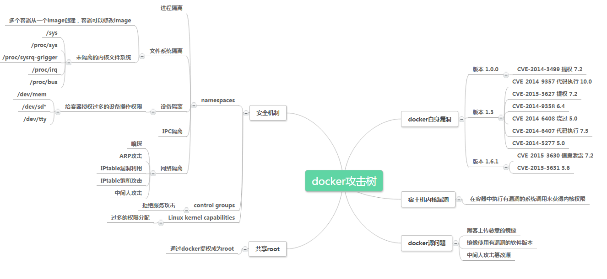

Docker
----------------------------------------
Docker is currently one of the most representative container platforms, with advantages such as continuous deployment and testing, and cross-cloud platform support. In a container cloud environment based on container orchestration tools such as Kubernetes, by scheduling cross-host cluster resources, the container cloud can provide functions such as resource sharing and isolation, container orchestration and deployment, and application support.

Basic concepts
~~~~~~~~~~~~~~~~~~~~~~~~~~~~~~~~~~~~~~~~
Docker has three basic concepts: Image, Container, and Repository. A mirror is a read-only template consisting of a set of file systems using Union FS technology.

An image is a static definition, and a container is a running instance created from the image. The essence of a container is a process, which has its own independent namespace.

Repository is a place where image files are stored centrally and is used to store and distribute images.

Containers can be started, started, stopped, and deleted. Each container is isolated from each other. The container can be regarded as a simplified version of the Linux environment (including root user permissions, process space, user space, network space, etc.) and the applications running in it.

composition
~~~~~~~~~~~~~~~~~~~~~~~~~~~~~~~~~~~~~~~~
The Docker engine consists of the following main components: Docker Client, Docker daemon, containerd and RunC, which are jointly responsible for the creation and running of containers.

Docker Client is a client that establishes communication with Docker Daemon. Docker Client can establish communication with Daemon through http/unix socket and other methods.

Docker Daemon is a daemon for container management. It runs on the host and serves as a server to accept requests from clients. Its main functions include image management, image construction, REST API, authentication, security, core network and orchestration. The Docker daemon implements the Docker remote API through the local IPC/Unix socket located at ``/var/run/docker.sock``. The default non-TLS network port is 2375, and the default TLS port is 2376.

containerd emerged after the standardization of container technology to separate the container runtime from the Docker Daemon. The main responsibilities of containerd are image management and container execution.

RunC is a specific implementation of Docker in accordance with the OCF standard, which implements functions such as container starting and stopping, resource isolation, etc.

data
~~~~~~~~~~~~~~~~~~~~~~~~~~~~~~~~~~~~~~~~
Docker's data is mainly divided into persistent and non-persistent data. By default, non-persistent storage is automatically created with the same life cycle as the container. Deleting the container will also delete non-persistent data. In the Linux environment, non-persistent data is stored under ``/var/lib/docker/`` by default.

network
~~~~~~~~~~~~~~~~~~~~~~~~~~~~~~~~~~~~~~~~
The Docker network architecture is derived from a solution called the container network model, which is mainly constructed by CNM, Libnetwork, and network drivers.

Security Risks and Security Mechanisms
----------------------------------------
When considering Docker security, consider the following points:

- The security of the kernel itself and its support for namespaces and cgroups
- The attack surface of the Docker daemon itself
- The "hardened" security features of the kernel and how they interact with containers

Docker security baseline
~~~~~~~~~~~~~~~~~~~~~~~~~~~~~~~~~~~~~~~~
|benchsec|

Kernel namespace/namespace
~~~~~~~~~~~~~~~~~~~~~~~~~~~~~~~~~~~~~~~~
Docker containers are very similar to LXC containers and have similar security features. When you start a container using docker run, Docker creates a set of namespaces and control groups for the container in the background.

Namespaces provide the most straightforward form of isolation: processes running in a container cannot see or influence processes running in another container or on the host system.

Each container also has its own network stack, which means that one container cannot gain privileged access to another container's sockets or interfaces. Of course, containers can interact via their respective network interfaces if the host system is set up accordingly. IP communication is allowed between containers if you specify a public port for the container or use a link.

They can ping each other, send/receive UDP packets, and establish TCP connections, but they can be restricted if needed. From a network architecture perspective, all containers on a given Docker host are on bridge interfaces. This means they are connected just like physical machines via a regular Ethernet switch.

Control Group
~~~~~~~~~~~~~~~~~~~~~~~~~~~~~~~~~~~~~~~~
Control groups are another key component of Linux containers. Their main function is to implement resource accounting and restrictions.

Cgroups provide many useful metrics, but also help ensure that each container gets its fair share of memory, CPU, and disk I/O; more importantly, individual containers cannot degrade system performance by exhausting resources.

Therefore, although Cgroups cannot prevent one container from accessing or affecting another container's data and processes, they are critical for protecting against some denial-of-service attacks. They are especially important for multi-tenant platforms, such as public and private PaaS, to guarantee consistent uptime (and performance) even when some applications start to misbehave.

Daemon attack surface
~~~~~~~~~~~~~~~~~~~~~~~~~~~~~~~~~~~~~~~~
Running containers with Docker means running the Docker daemon, and this daemon currently requires root privileges, so the daemon is one place to consider.

First, only trusted users are allowed to control the Docker daemon. Specifically, Docker allows you to share a directory between the Docker host and guest containers; it allows you to do so without restricting the container's access permissions. This means that a container can be started where the /host directory will become the / directory on the host and the container will be able to make changes to the host file system without any restrictions.

This has strong security implications: for example, if you are testing Docker via a web server to configure a container via an API, parameter checking should be done more carefully to ensure that a malicious user cannot pass crafted parameters that would cause Docker to create arbitrary containers.

The daemon may also be susceptible to other inputs, such as loading an image from disk with docker load or from the network with docker pull.

Ultimately, it is expected that the Docker daemon will run with restricted privileges, delegating operations to well-audited child processes, each with its own (very limited) scope of Linux functionality, virtual network settings, file system management, etc. That is, most likely, parts of the Docker engine itself will run in containers.

Capability
~~~~~~~~~~~~~~~~~~~~~~~~~~~~~~~~~~~~~~~~
By default, Docker uses the Capability mechanism to allow users to run containers as root while restricting some root operations.

In most cases, containers do not require true root privileges. Therefore, Docker can run a collection with lower Capability, which means that the root in the container is much less than the real root. For example:

- Deny all mount operations
- Deny access to raw sockets (prevent packet spoofing)
- Deny access to certain file system operations, such as creating new device nodes, changing a file's owner, or modifying attributes (including the immutable flag)
- Reject module loading
- other

This means that even if an intruder obtains root privileges within the container, further attacks will be much more difficult. By default, Docker uses a whitelist instead of a blacklist, removing all non-essential functionality.

Seccomp
~~~~~~~~~~~~~~~~~~~~~~~~~~~~~~~~~~~~~~~~
Docker uses Seccomp to limit system calls initiated by the container to the host kernel.

