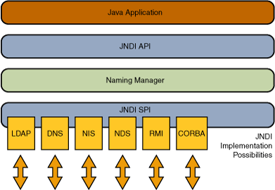

JNDI
========================================

Introduction
----------------------------------------
JNDI (Java Naming and Directory Interface, Java Naming and Directory Interface) is an API that provides naming and directory access services for Java applications. It allows clients to discover and look up data and objects by name, and is used to provide dynamic calls based on configuration. These objects can be stored in different naming or directory services such as RMI, CORBA, LDAP, DNS, etc.

The Naming Service is similar to the K/V pair of the hash table, and the corresponding service is obtained through the name. Directory Service is a special Naming Service that uses a directory-like method to access services.

|jndiarch|

JNDI injection
----------------------------------------
JNDI injection was proposed by pentester in the ``A Journey From JNDI LDAP Manipulation To RCE`` topic on BlackHat USA in 2016.

The attack process is as follows

1. The attacker binds the payload to the attacker’s naming/directory service
2. Attacker injects absolute URL into vulnerable JNDI lookup method
3. Application performs lookup
4. The application connects to the attacker-controlled JNDI service and returns the payload
5. Application decodes response and triggers payload

Attack payload
----------------------------------------
JDNI has several main attack payloads:

- CORBA
- IOR
- JNDI Reference
- LDAP
- Remote Location
- Remote Object
- RMI
- Serialized Object

RMI Remote Object
~~~~~~~~~~~~~~~~~~~~~~~~~~~~~~~~~~~~~~~~
The attacker implements an RMI malicious remote object and binds it to the RMI Registry, and places the compiled RMI remote object class on HTTP/FTP/SMB and other servers. The Codebase address is set by the ``java.rmi.server.codebase`` property of the remote server for remote loading by the victim's RMI client.

The conditions of use are as follows:

- The RMI client context allows access to remote codebases.
- The value of the property ``java.rmi.server.useCodebaseOnly`` is false.

Among them, after JDK 6u45 and 7u21, the value of ``java.rmi.server.useCodebaseOnly`` defaults to true.

RMI + JNDI Reference
~~~~~~~~~~~~~~~~~~~~~~~~~~~~~~~~~~~~~~~~
The attacker returns a JNDI Naming Reference through the RMI service. When the victim decodes the Reference, it will load the Factory class at the remote address specified by the attacker. In principle, this method does not use the RMI Class Loading mechanism, so it is not restricted by the ``java.rmi.server.useCodebaseOnly`` system property. However, after JDK 6u132, JDK 7u122, and JDK 8u113, the feature of JNDI Reference remotely loading the Object Factory class in the Naming/Directory service is restricted. The default values ​​of the system properties ``com.sun.jndi.rmi.object.trustURLCodebase`` and ``com.sun.jndi.cosnaming.object.trustURLCodebase`` are changed to false, which means that the Reference factory class is not allowed to be loaded from the remote Codebase by default.

LDAP + JNDI Reference
~~~~~~~~~~~~~~~~~~~~~~~~~~~~~~~~~~~~~~~~
Java's LDAP can store specific Java objects in attribute values, and the Reference remote loading Factory class of the LDAP service is not restricted by attributes such as ``com.sun.jndi.rmi.object.trustURLCodebase`` and ``com.sun.jndi.cosnaming.object.trustURLCodebase``, and has a wider scope of application.

